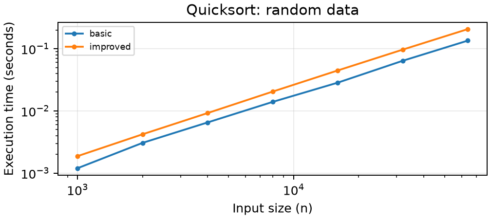
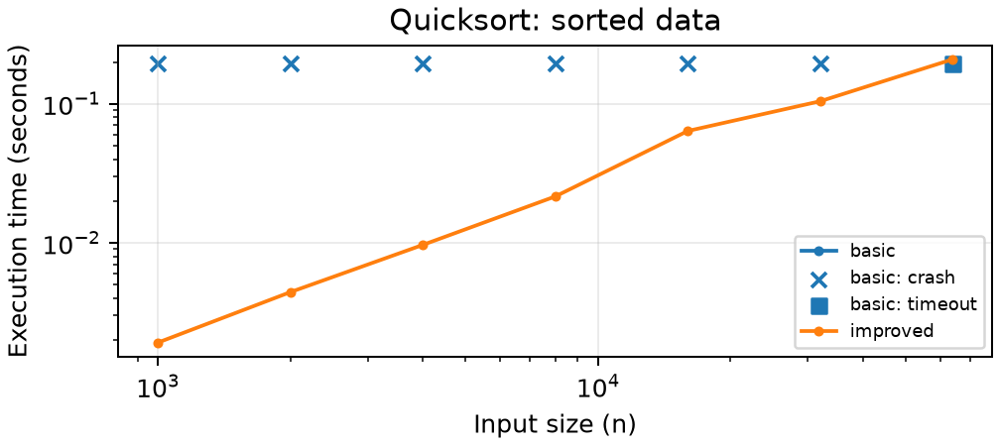
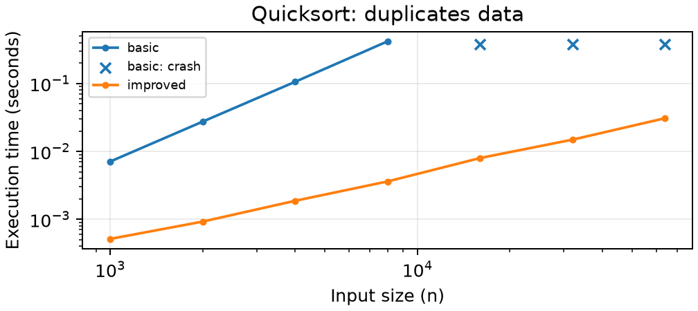
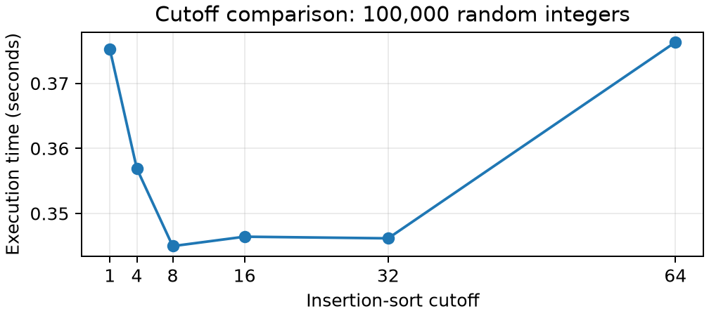

# Assignment 3: Fixing a Slow Quicksort

**Student:** Yeshey Lhaden (02240371)  
**Experiment date:** 31st October 2026

**AI Use Declaration:** ChatGPT/Codex by OpenAI was utilized to assist with Python programming, test creation, performance testing, and concept clarification.

## Table of Contents

1. [Introduction](#1-introduction)
2. [Implementation](#2-implementation)
3. [Testing Results](#3-testing-results)
4. [Performance Analysis](#4-performance-analysis)
5. [Worst-Case Recurrence Analysis](#5-worst-case-recurrence-analysis)
6. [Cutoff Optimization](#6-cutoff-optimization)
7. [Comparison with Python's sorted()](#7-comparison-with-pythons-sorted)
8. [Critical Reflection](#8-critical-reflection)
9. [Conclusion](#9-conclusion)

## 1. Introduction

Sorting of mobile payments is done at a bank in Thimphu. Ordered data and repeated values of Nu. 100 and Nu. 500 top-ups make quick sort run at its worst time. Comparison between quick sort last pivot and randomized duplicate detection versions is performed.

## 2. Implementation

**Basic**: sorts.py performs Lomuto partitioning. There is a boundary that separates amounts that are less than or equal to the pivot amount at the last element from those amounts which are greater than the pivot amount. The pivot amount is then placed into its final position, and recursive sorting takes place for the two sides. For balanced partitions, the running time complexity is T(n) = 2T(n/2) + Θ(n) = Θ(n log n). In case of random distinct-key permutations, Θ(n log n) time complexity is obtained by average pivot rank.

**Improvement:** choose a random pivot and split around it into three parts - less than, equals, and greater than parts. No need to sort the equal part as it contains equal elements; Θ(n) time is needed. Apply insertion sort if the length of the partition does not exceed the cutoff value. Only recur on the smaller partition while processing the larger one. Each level in recursion contains partitions that do not exceed half the size of its parent partition; hence, the depth of recursion is O(log n). Expected time complexity is O(n log n); worst-case time complexity is O(n²).

## 3. Testing Results

Passed four unittest test methods in the executed suite. It tests 500 seeded lists of lengths from 0 to 200 by sorted(), using basic quicksort and six better cut-offs (1, 4, 8, 16, 32, 64): 3,500 random tests of algorithm/cut-off combinations. Other test cases include empty, single item, equal, ascending, descending, negative, repeating and sign-mixed items. Test cases validate alias visibility mutation, list identity, None return values and algorithm agreement. Improved version passed three test cases with 10,000 items, ordered or equal; it raises ValueError for invalid cut-offs.

**Environment and reproduction:** CPython 3.14.4, macOS 26.5, ARM64; default recursion limit 1,000. Run `.venv/bin/python -m unittest -v`, then `MPLCONFIGDIR=/tmp/quicksort-mpl .venv/bin/python benchmark.py`. Full metadata is in environment.txt. Timings are machine-specific wall-clock measurements, not theoretical operation counts.

<!-- pagebreak -->

## 4. Performance Analysis

**Table 1. Median seconds, three trials where successful.** B = basic, I = improved (cutoff 16). CRASH means actual RecursionError; it is not a zero timing.

| n | Random B / I | Sorted B / I | Duplicates B / I |
|---:|---|---|---|
| 1,000 | 0.001196 / 0.001871 | CRASH / 0.001917 | 0.007084 / 0.000513 |
| 2,000 | 0.003061 / 0.004207 | CRASH / 0.004423 | 0.027461 / 0.000923 |
| 4,000 | 0.006525 / 0.009233 | CRASH / 0.009672 | 0.106040 / 0.001870 |
| 8,000 | 0.013960 / 0.020446 | CRASH / 0.021574 | 0.419052 / 0.003609 |
| 16,000 | 0.028462 / 0.044704 | CRASH / 0.063812 | CRASH / 0.007982 |
| 32,000 | 0.064063 / 0.096817 | CRASH / 0.104413 | CRASH / 0.014910 |
| 64,000 | 0.135071 / 0.206901 | TIMEOUT / 0.209143 | CRASH / 0.030824 |

Inputs are shared among algorithms, each getting new input for each run. Random numbers range from 0 to 999,999; duplicated numbers range from 0 to 9. Seed inputs for inputs are 302+n; seed inputs for pivots are 302-304. Timing is performed by using perf_counter() only during sorting; copy, process start and sorted() checking is not counted. All tests are run independently in separate processes. Worker process timeout of five seconds includes startup/checking; first crash or timeout terminates test. Successful medians need three successful tests. Status, successful test counts and time taken are saved in CSVs. Basic algorithm was quicker in random numbers (0.135071 s vs 0.206901 s for n=64,000). For 8,000 values with a lot of duplicates, improved algorithm worked in 0.003609 s vs 0.419052 s for basic. 9 crashes, 1 timeouts and 0 skipped tests.

<!-- pagebreak -->

## 5. Worst-Case Recurrence Analysis

With ascending inputs, the last pivot will be the maximum. For all n − 1 elements before that, the Lomuto's <= test will apply, yielding two partitions of sizes n − 1 and zero, respectively. The scanning process takes Θ(n), although the input is sorted. We have that T(n) = T(n − 1) + Θ(n), with an O(1) base case. Unrolling yields Θ(n + (n − 1) + ... + 1) = Θ(n(n + 1)/2) = Θ(n²). There will be Θ(n) recursive calls, resulting in the Python error RecursionError due to finite number of allowed recursive calls. When the numbers are all the same, <= test will put all elements except for the first into one of the partitions. The randomization of the pivot will not solve this problem.

## 6. Cutoff Optimization

**Table 2. Three-trial medians on the same 100,000 random integers.**

| Cutoff | 1 | 4 | 8 | 16 | 32 | 64 |
|---|---|---|---|---|---|---|
| Median seconds | 0.375225 | 0.356902 | 0.344982 | 0.346430 | 0.346177 | 0.376319 |

The optimal cutoff value measured is **8**, which occurs at **0.344982 seconds**. Insertion sorts do not incur overhead because they perform no recursion but have easy to comprehend loops. They incur quadratic time complexity that is constrained by the small partition size, and their time complexity is O(nk) for cutoff k. Extremely high cutoff values increase shifting time.

## 7. Comparison with Python's sorted()

In another three-run comparison on the same seeded array with 100,000 elements, an improvement in quicksort (cutoff 8) was recorded at **0.373789 s**, while sorted() took only **0.017612 s**. The improvement factor of improved / sorted is **21.22**. So, sorted() ran 21.22 times faster than improved quicksort. Note that sorted() involves allocation of the results list, whereas none of them involves copying of the input list. CPython’s adaptive Timsort takes advantage of any pre-existing runs and runs optimized C code, whereas our swap, compare and loop iterations run in Python code.

## 8. Critical Reflection

**Question 1: Why did the basic algorithm fail?** For increasing transaction values, the last pivot is always the highest. This is why Lomuto ends up with an almost unaltered sub-problem and linear recursion. For these tests, 9 out of 12 initial input size cases resulted in a RecursionError. These included 6 cases of increasing input sizes; of these, the highest increasing input size case was a timeout status. In this analysis, we have assumed the use of random relative order for the input or alternatively, a random selection of pivot points, which is not the case for the bank’s ordered records.

**Question 2: Why use insertion sort?** A quadratic algorithm is still useful for a small partition in that there is no need for further partitioning, choosing of pivots, and function callings. For a fixed cutoff value of k, the insertion work done within the small partitions is O(nk). The fastest cutoff value recorded is 8, with a median of 0.344982 seconds when sorting 100,000 randomly generated integers. This is an optimal cutoff value for this implementation and the machine being used and not universally.

**Question 4: How was AI assistance checked?** ChatGPT/Codex was employed for the development, testing, benchmarking, and explanation. Automated tests were run for both algorithms against Python's sorted() on 500 deterministic and clearly defined test cases. The benchmark confirmed each successful result and recorded any crash results as NaNs. The tests prove correctness and measured behavior, but cannot substitute for your analysis of the invariants of the partition algorithm and experimental setup. Student verification necessary: execute the commands yourself, examine the code and CSV data, and verify that the statement correctly reflects your use of AI technology.

## 9. Conclusion

Pivot choice in randomness mitigates order sensitivity, three-way split accommodates multiple repetitions, and recursion on the smaller side controls stack buildup. The flaws found in the original algorithm's performance account for why a solution that is effective on random inputs will not necessarily work on regular banking data. Cutoff value 8 turned out to be the best one in the cutoff testing process; sorted() from Python performed better in the direct test.
