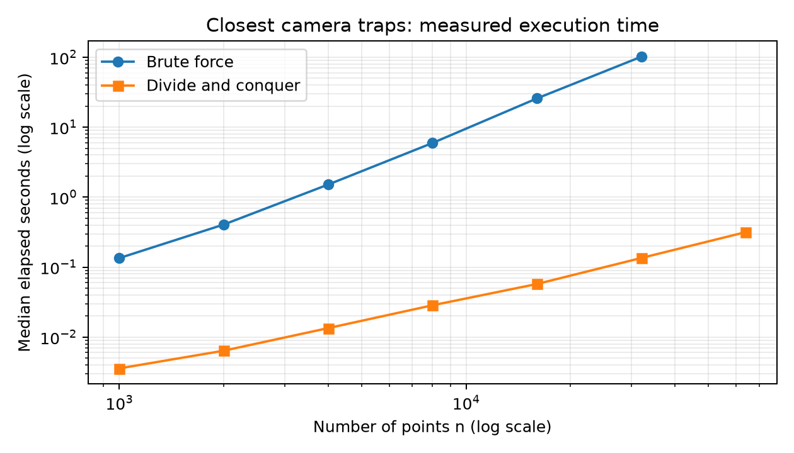
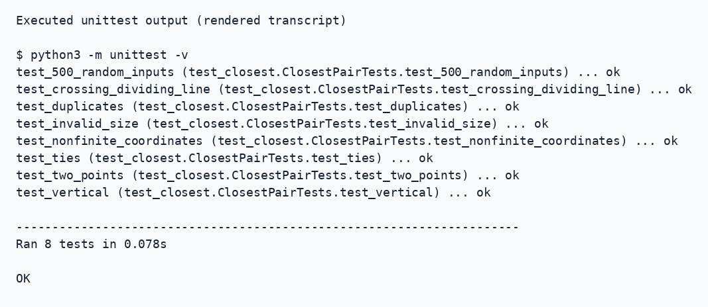
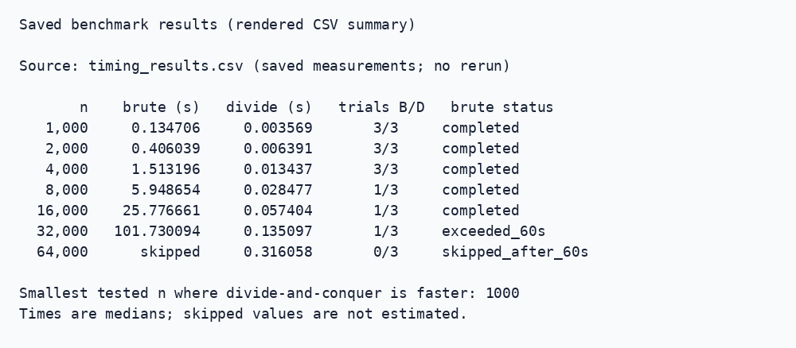

# CSF302 — Assignment 2: Closest Camera Traps

**Student:** Yeshey Lhaden (02240371)  
**Experiment date:** 28th October 2026

## Table of Contents

1. [Implementation and correctness](#implementation-and-correctness)
2. [Recurrence analysis](#recurrence-analysis)
3. [Validation and measured performance](#validation-and-measured-performance)
4. [Critical reflection](#critical-reflection-three-questions-under-400-words)
5. [Reproduce and prepare submission](#reproduce-and-prepare-submission)
6. [Execution evidence](#execution-evidence)
   - [Test results](#test-results)
   - [Benchmark evidence](#benchmark-evidence)
7. [Conclusion](#conclusion)

## Implementation and correctness

In both cases, `closest.py` will output `(d, i, j)` where the values are zero-based indexing such that `i < j`. In case of ties for distances, then the choice will be made on the lexicographically smaller `(i, j)`, for example, `(0, 3)` over `(1, 2)`. If less than two points are given, an error message is raised, `ValueError`.

For the function `closest_pair_brute`, all pairs are iterated through, their distances are found, and then the smallest `(distance, i, j)` is returned. The comparison works from left to right in tuples in Python.

The `closest_pair` algorithm adds a prefix to each input index while sorting. `closest_pair` sorts twice, once by x and once by y. The x-rank dictionary is used to decide which half the point is on, even in the case when there are many equal x-coordinates. Brute force is used for solving problems with three points or less.

This recursive computation gives a bound on the distance, delta. If a pair crosses the boundary and is close to each other, then that pair must be situated in the strip of width delta near this line. This strip is already sorted by the y coordinate. Using packing arguments, we get the number of such points, because for each half, all points are separated by at least delta. Partitioning the rectangle of size delta by delta into four squares with side delta/2 makes sure that there will be at most one point per square, because the diagonal of each square has a length less than delta. It shows that only a constant number of successors needs to be considered in both halves. The algorithm considers no more than 15 successors and terminates if the difference between y coordinates becomes larger than the distance bound.

Co-linear points are found using the first x-sorted list. Since the indices of elements within the same duplicate set are in increasing order, the smallest indices will occur at the first consecutive pair. The optimum duplicate pair among all groups yields the right result for the distance of zero, without producing the heavy zero-width strip. Working space is O(n).

## Recurrence analysis

Besides the first O(n log n) sorting algorithm, the remaining recursion satisfies all the requirements:

**T(n) = 2T(n/2) + Θ(n)** with a base case of constant size.

Two subproblems of size n/2 each exist. Separation of the points by y-coordinate and the creation/scanning of the strip takes O(n) time per function call. From the Master Theorem, **a = 2**, **b = 2**, and **f(n) = Θ(n)**. So, **n^(log_b a) = n^(log₂ 2) = n**. Since f(n) = Θ(n^(log_b a)), **Case 2** will be used and the answer is **T(n) = Θ(n log n)**. Subproblems that are of odd sizes and unbalanced are included in this solution. The initial sort itself has the same complexity, making the overall runtime Θ(n log n).

The brute-force solution requires the comparison of all possible pairs of points: n(n−1)/2 pairs. Comparisons have a constant time complexity. The solution runtime is thus **Θ(n²)**.

<div style="page-break-before: always;"></div>

## Validation and measured performance

`python3 -m unittest -v` successfully ran all **8 test Tests** are conducted, from which **500 randomly created** sets of 2 to 50 points with seed 302. Half of the random tests are performed on points having integer coordinates, while the other half is done on points having continuous coordinates. These tests help to check the validity of distances and index pairs of the points. The mentioned tests include two points, duplicates, vertical points, pair of points passing through the split point, ties, invalid input size, and non-finite coordinate points. An additional exhaustive test has been performed as well.

The `benchmark.py` employs seed 302 and uniformly distributed points in [0, 1)². The two algorithms receive the same points at each n. Input generation is not timed using `time.perf_counter()`, however the validation and sorting done within the algorithms are considered in their time. The divide-and-conquer algorithm is run three times at each point. The brute-force algorithm is run three times when n ≤ 4,000, while once at any other point. The numbers presented in the following are medians; while the median calculated based on one trial is not reproduced. The sample values and number of repeats are saved in the `timing_results.csv` file. When a trial with the brute-force algorithm takes more than 60 seconds, all other trials with greater n are skipped.

| n | Brute force (s) | Divide and conquer (s) |
|---:|---:|---:|
| 1,000 | 0.134706 | 0.003569 |
| 2,000 | 0.406039 | 0.006391 |
| 4,000 | 1.513196 | 0.013437 |
| 8,000 | 5.948654 | 0.028477 |
| 16,000 | 25.776661 | 0.057404 |
| 32,000 | 101.730094 | 0.135097 |
| 64,000 | Skipped | 0.316058 |

Environment: Python 3.14.4, macOS-26.5-arm64-arm-64bit-Mach-O (as recorded in the benchmark terminal output). Brute force took **101.730 seconds at 32,000**, triggering the stop condition; brute force at 64,000 was skipped. The smallest tested n where divide and conquer was faster was **1,000** (0.003569 s compared to 0.134706 s). The crossover below 1,000 was not measured.



<div style="page-break-before: always;"></div>

## Critical reflection (three questions; under 400 words)

**1. Did growth match the recurrence?** Brute force rose from 0.134706 s at 1,000 points to 101.730094 s at 32,000 points, an increase of 755.2 times for 32 times more points. Quadratic growth predicts 1,024 times. Divide and conquer rose from 0.003569 s at 1,000 points to 0.316058 s at 64,000 points, an increase of 88.6 times; n log₂ n growth predicts about 102.8 times. These measurements broadly support the predicted growth rates, with timing variation and limited trials affecting the ratios.

**3. Which edge case required most care, and how did testing help?** Here, the use of equidistant pairs together with original index based tie breaking required additional consideration. Actually, distance alone would yield another pair of indices. Equidistant x values must be divided according to x ranking and not just their coordinate values. Such considerations were considered in tuple comparisons, strip bounding, and duplicate prechecks. Duplicate group, grid tie, vertical line, and random integers test cases were tested using brute force.

**4. How was AI assistance verified?** Implementation, testing, benchmarking, and explanation have been done with the help of ChatGPT/Codex. The code has been tested using 8 methods of tests, which include 500 random seed-based test methods and 502 grid subset exhaustive tests. The benchmark confirmed equality of all sizes used by both test methods. This is an evidence for the correctness of code, but it is not a substitute for the review of the strip argument and ties. The student's personal review is pending.

## Reproduce and prepare submission

Run from the project directory:

```sh
python3 -m unittest -v
python3 -m venv .venv
.venv/bin/python -m pip install matplotlib
.venv/bin/python benchmark.py
```

The commands above create a local virtual environment and install matplotlib for plotting the graph. The algorithms and tests use only the Python standard library. The benchmarking will overwrite the CSV file and the plot; update this report if you receive other results.

**AI-use acknowledgement:** OpenAI’s ChatGPT/Codex AI was used in helping to implement, test, benchmark, and explain the project.

**Student completion:** Enter your name/ID, check the code and measurements, and make sure that the reflection reflects your understanding. Practise explaining original-index tracking, y-order partitioning, strip packing, and the Master Method. Generate this report as a PDF file and check that the PDF is no longer than four pages, including the reflection. Recommendation for layout: A4 size, 11pt text, 18 mm margins, graph resized to fit the text width, with the supplied page breaks intact. There is no PDF generator available in this environment.

<div style="page-break-before: always;"></div>

## Execution evidence

These images render authentic output as readable transcripts; they are not desktop screenshots. The test output was captured on 9 November 2026. The benchmark summary reads the existing `timing_results.csv` from the completed 9 November 2026 run; the evidence images use those saved measurements without rerunning or estimating timings.

### Test results



**Figure 2.** Actual output from a fresh `python3 -m unittest -v` run. The test named `test_500_random_inputs` performs the 500 comparisons.

### Benchmark evidence



**Figure 3.** Saved CSV measurements, including the 60-second stop rule and smallest tested winning size. B/D means brute-force/divide-and-conquer trial counts. The labelled log-log graph appears in the performance section.

Source text and a reproducible capture script are included in `screenshots/`.

## Conclusion

Both closest-pair algorithms were developed and verified through 500 random seed trials, edge cases tests, and 502 exhaustive grid subset trials. This data provides evidence of the expected Θ(n²) time complexity for brute force algorithm and Θ(n log n) time complexity for divide and conquer algorithm. Brute force takes 101.730 seconds for 32,000 points, whereas divide and conquer takes 0.135 seconds. Divide and conquer is faster at all sizes tested with both algorithms and took 0.316 seconds to finish 64,000 points. These measurements demonstrate its performance advantage on the tested inputs.