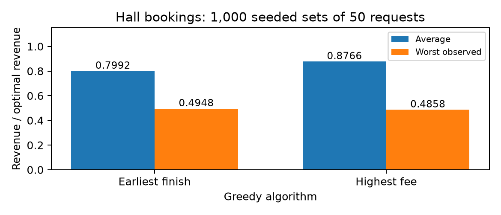

# Assignment 4: Booking the Hall

**Student:** Yeshey Lhaden (02240371)  
**Experiment date:** 3rd November 2026

**AI Use Declaration:** OpenAI ChatGPT/Codex was used to assist with Python implementation, test development, experimental analysis, and explanation of greedy and dynamic programming algorithms. All generated code and experimental results will be reviewed and verified by the student before submission.

**Student:** Yeshey Lhaden (02240371)

## Table of Contents

1. [Introduction](#1-introduction)
2. [Algorithm Implementation](#2-algorithm-implementation)
3. [Testing Results](#3-testing-results)
4. [Greedy Counterexamples](#4-greedy-counterexamples)
5. [Dynamic Programming Analysis](#5-dynamic-programming-analysis)
6. [Revenue Ratio Analysis](#6-revenue-ratio-analysis)
7. [Time Complexity Comparison](#7-time-complexity-comparison)
8. [Critical Reflection](#8-critical-reflection)
9. [Conclusion](#9-conclusion)

## 1. Introduction

The Paro community hall receives requests (start, finish, fee). Only one event can occupy the hall at a time; a finish equal to the next start is compatible. The objective is maximum revenue. Two greedy rules are compared with weighted interval dynamic programming (DP) and exhaustive search.

## 2. Algorithm Implementation

Earliest finish sorts by (finish, start, original index) and accepts each compatible request. With equal positive fees, it maximizes activity count: exchange the first activity in an optimal schedule for the earliest-finishing one. This leaves at least as much room for later bookings; repeat on the remaining activities. Unequal fees invalidate the revenue conclusion.

Highest fee sorts by descending fee, breaking ties by original index, and checks each candidate against every accepted booking. One large fee can block a more valuable combination.

DP uses finish sorting, binary-searched predecessors, a revenue table and backwards reconstruction. On equal include/exclude revenue it excludes the later finish-sorted booking. Brute force independently enumerates every finish-order subset bitmask, keeping the first maximum. Both have deterministic ties. Output indices are original indices in chronological order; input lists are unchanged. The assumed domain is start < finish with nonnegative fees. Brute force rejects n > 15.

## 3. Testing Results

Five unittest methods passed on 9 November 2026. They include 500 random inputs of size 0-10 (seed 302), comparing DP with independent brute force, and 200 random equal-positive-fee inputs (seed 304), confirming earliest finish equals optimal revenue. Tests cover empty and singleton inputs, all-overlapping and nonoverlapping requests, back-to-back bookings, unequal/equal/zero fees, shared start/finish times, duplicate requests, multiple optima and both greedy failures. Every algorithm is checked for valid original indices, no duplicate selections, compatibility, fee sums, repeatability and unchanged input. The brute-force limit is tested at 15 and above it. Tests supply evidence, not a proof for every possible input.

## 4. Greedy Counterexamples

Earliest finish: requests [(0, 2, 3), (0, 3, 8)]. Greedy (3, [0]); optimal (8, [1]); loss 5. The early booking blocks the overlapping booking worth 8.

Highest fee: requests [(0, 4, 7), (0, 2, 4), (2, 4, 4)]. Greedy (7, [0]); optimal (8, [1, 2]); loss 1. The fee of 7 blocks two compatible bookings worth 8 together.

Outputs are (total fee, original indices). Both optimal revenues were verified by exhaustive enumeration.

## 5. Dynamic Programming Analysis

Number finish-sorted requests 1 through n. OPT(j) is maximum revenue among the first j requests, with OPT(0)=0. fee_j is booking j's fee. p(j) is the last preceding booking finishing no later than j starts, or 0 if none. In code, bisect_right returns the count of such preceding bookings: this count is exactly their prefix index in the 1-based DP table. Search excludes j itself.

OPT(j) = max(OPT(j-1), fee_j + OPT(p(j))).

An optimal schedule either excludes j, giving OPT(j-1), or includes j, leaving only its compatible prefix available. The prefix schedule must be optimal: replacing it by a better prefix schedule would improve the whole solution. Therefore inclusion gives fee_j + OPT(p(j)), and the maximum is optimal by induction. This is optimal substructure. Storing each prefix once avoids repeated calculations. Reconstruction follows an inclusion to p(j), otherwise to j-1.

Example in finish order: (0,2,4), (0,4,7), (2,4,4). Here p=[0,0,1] and OPT=[0,4,7,8]. Including the last booking yields 4+OPT(1)=8 rather than 7.

## 6. Revenue Ratio Analysis

Exactly 1,000 sets of 50 requests use random.Random(302). Independent inclusive integer draws give start 0-99, duration 1-20 and fee Nu. 0-10,000; finish=start+duration. Time uses synthetic units, not a daily opening-hours model. Each trial gives identical inputs to both greedy rules and DP; brute force is excluded. Ratio=greedy/optimal; zero optimum is assigned ratio 1 because both revenues are zero. No greedy revenue exceeded optimal revenue. Every trial is saved in CSV.

| Algorithm | Average ratio | Worst observed ratio |
|---|---:|---:|
| Earliest finish | 0.799225 | 0.494816 |
| Highest fee | 0.876640 | 0.485801 |

Figure 1 uses decimal ratios; 1 means optimal revenue. The minimum observed ratio is a sample statistic, not a theoretical worst-case guarantee.

## 7. Time Complexity Comparison

| Algorithm | Time | Auxiliary space |
|---|---|---|
| Earliest finish | O(n log n) | O(n) |
| Highest fee | O(n²) | O(n) |
| DP | O(n log n) | O(n) |
| Brute force | O(n × 2ⁿ) | O(n) |

Earliest finish sorts then scans once. Highest fee sorts and can perform O(n) compatibility checks for each candidate; final output sorting is dominated by O(n²). DP sorting and n binary searches cost O(n log n); filling and reconstructing each cost O(n). Brute force sorts once and scans at most n bookings per subset in finish order. Adjacent checks suffice for compatibility. It stores one subset at a time. Exponential growth prevents large-input use.

## 8. Critical Reflection

**Question 1: What do passing tests establish?** Passing tests cannot prove a greedy rule correct on every input. The earliest-finish example loses 5, while highest fee loses 1. A single counterexample disproves universal optimality. Brute-force comparisons on 500 small random inputs help find DP errors; the include/exclude proof supplies general justification.

**Question 2: Should the manager keep the simple rule?** Earliest finish averaged 0.799225 of optimal revenue, with minimum 0.494816; highest fee averaged 0.876640, with minimum 0.485801. These losses favor DP for revenue. Earliest finish remains appropriate for maximizing booking count with equal positive fees. Greedy rules are simple, but neither guarantees weighted optimality. DP has the same asymptotic time bound as earliest finish here. Real demand may produce different ratios from synthetic requests.

**Question 4: How was AI assistance checked?** AI helped with implementation, tests and explanation. No claim is made that AI previously called a greedy rule optimal. Both small counterexamples were exhaustively checked, DP was compared against brute force, and the 1,000 experiments checked greedy revenues against DP. Student review remains necessary: run the commands, inspect the code and CSV, understand the recurrence and confirm the declaration accurately reflects actual AI use.

## 9. Conclusion

Weighted interval DP maximizes revenue for this model. Earliest finish optimizes activity count with equal positive fees; highest fee can miss valuable combinations. The manager should use DP for revenue and check whether real operating constraints require an expanded model.

Verified environment: Python 3.14.4, macOS-26.5-arm64-arm-64bit-Mach-O; matplotlib 3.11.2.
